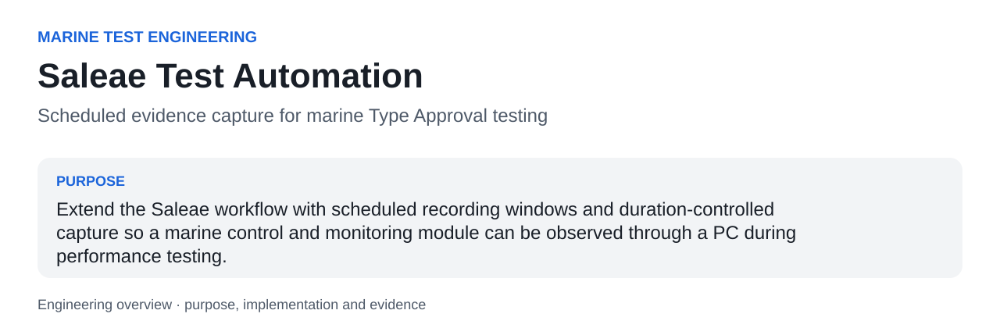
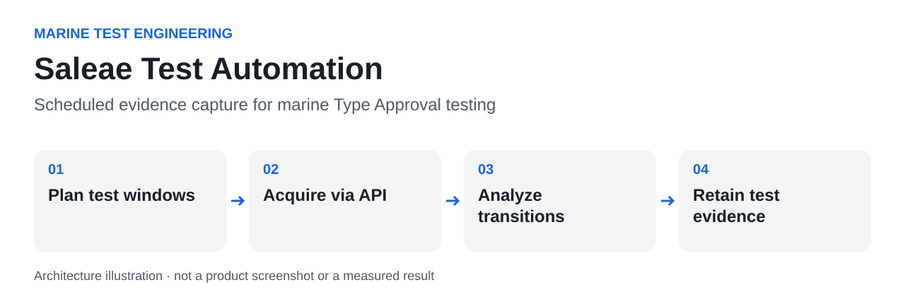

<a id="readme-top"></a>



# Saleae Test Automation

**Scheduled evidence capture for marine Type Approval testing.**

Extend the Saleae workflow with scheduled recording windows and duration-controlled capture so a marine control and monitoring module can be observed through a PC during performance testing.

| At a glance | |
|---|---|
| Context | Marine Test Engineering |
| Current evidence | Used in product performance logging; hardware integration not rerun in this checkout |
| Stack | Python, PySide6, Saleae Logic 2 Automation API, PowerShell |
| Author | [hupositoc](https://github.com/hupositoc) |

[Case study](docs/case-study.md) · [Architecture](docs/architecture.md) · [Validation](docs/validation.md) · [Design rationale](docs/design-rationale.md)

## Table of Contents

- [About The Project](#about-the-project)
- [Getting Started](#getting-started)
- [Usage](#usage)
- [Roadmap](#roadmap)
- [Contributing](#contributing)
- [License](#license)
- [Contact](#contact)
- [Acknowledgments](#acknowledgments)

## About The Project

### Why I built it

The author used this software while supporting Type Approval activities for a Control and Monitoring Module for Marine under test plans referring to DNV-CG-0339 and LR-TS-01. Product identities, employers, laboratories, and customer names are withheld.

The test setup required PC-based logging of CAN/SSI communication and periodic operating-status signals. The workflow needed reservation-style start/stop times and timed recording periods that the author could not obtain from the Saleae application workflow used on site. Repeating these operations manually made the operator part of the acquisition schedule.

### What I implemented

Build a Python desktop application around the vendor Automation API. Keep scheduling and user interaction on the GUI side, execute acquisition in a worker, and retain raw transitions alongside timestamped result and event logs. Separate the capture scheduler from experimental recovery utilities so ordinary recording does not silently inherit device-reset behavior.

### What this made possible

- Prepare start/stop windows before a test instead of manually starting every acquisition.
- Use duration and interval settings to collect the required portions of product performance data.
- Review captured clock and SSI behavior together with acquisition events rather than relying only on a live display.

### What happened in practice

The author confirms that the scheduler was used during actual product performance logging. Burst and surge energy also affected the PC USB path through the measurement setup and caused device disconnections. A USB isolator was introduced and resolved that connection problem. The repository does not attribute that physical-layer fix to its recovery code.

### Built With

Python, PySide6, Saleae Logic 2 Automation API, PowerShell. Dependencies provide integration capabilities; the source links below identify the project-specific behavior.

### Engineering decisions

### Use the vendor API

Explicit capture calls are more controllable than operating a desktop window through keystrokes. The legacy recovery experiment remains separate because its keyboard-driven behavior has different risks.

### Separate capture, analysis and evidence

A result summary should remain traceable to a captured interval. Raw transition exports and event timestamps support that traceability.

### Distinguish the device from the measurement chain

A broken USB session is a logging-system event, not by itself evidence that the marine module failed. Physical USB isolation addressed the reported disturbance path.

### Code to inspect

| Source entry point | Responsibility |
|---|---|
| [`SaleaeClockMonitorWindow`](sampling-assistant/app.py#L1686) | Owns configuration, scheduled start/stop windows, progress and operator actions. |
| [`SaleaeMonitorWorker`](sampling-assistant/app.py#L399) | Runs capture work away from the GUI thread. |
| [`analyze_reference_clock`](sampling-assistant/app.py#L298) | Checks reference-clock behavior in exported transitions. |
| [`analyze_ssi_clock_rx`](sampling-assistant/app.py#L333) | Analyzes the reconstructed SSI receive-side clock. |
| [`compare_to_baseline`](sampling-assistant/app.py#L363) | Compares analyzed values with configured reference behavior. |
| [`hard_restart`](recovery/saleae-guard/saleae_guard.py#L293) | Experimental software recovery path; not the confirmed isolation remedy. |

### AI-assisted engineering

I use AI development tools to turn concrete needs into working software. My engineering responsibilities include defining the problem, interpreting the operating constraints, reviewing behavior, investigating failures and checking results. AI assistance is a development method; it is not evidence that a feature works. File-by-file AI authorship or a specific assistant/model is not claimed without the corresponding development record.

## Getting Started

### Prerequisites

Windows, a compatible Saleae device, Logic 2 with Automation Server enabled, and Python with the listed packages.

### Installation

```text
git clone https://github.com/hupositoc/saleae-test-automation.git
cd saleae-test-automation
```

Then follow the project-specific path:

```text
python -m pip install -r requirements.txt
python sampling-assistant/app.py
```

The commands describe the intended setup. See the validation record for which parts were actually executed in the current environment.

## Usage



**Text equivalent:** Plan test windows → Acquire via API → Analyze transitions → Retain test evidence.

Start by defining the intended input and expected behavior. Save the configuration with the experiment or test session so that an output can be interpreted later. Review exceptions and raw evidence before treating a summary as a final conclusion.

Python AST parsing completed. Actual Logic 2/device capture, timing accuracy, USB disturbance behavior and duration limits have not been rerun in this preparation environment.

### Boundaries and known limitations

- Recorded use is author-confirmed; no private test report or certificate is published.
- Time saved, unattended test hours, recovery success rate and approval completion are not quantified.
- The software supports a test workflow; it is not a certified instrument and does not issue Type Approval.
- A watchdog may restart or terminate measurement processes. It must be evaluated independently from normal scheduled capture.

Read the [case study](docs/case-study.md) for the purpose and enabled workflow, and [architecture](docs/architecture.md) for the source-level explanation. The [validation document](docs/validation.md) separates verified checks, author-reported use and pending integration work.

## Roadmap

- [ ] Reproduce a scheduled start/stop test with a small public synthetic signal.
- [ ] Add device-disconnect and cancellation integration tests without publishing private captures.
- [ ] Document a neutral export schema and an example test-evidence package.

These are planned tasks, not completed capabilities.

## Contributing

Use an issue to describe a reproducible problem, expected behavior, actual behavior and the environment. For a change, keep the scope focused and attach the relevant test or recording. Do not submit private customer data, identifying test captures, credentials or confidential certification documents.

## License

Existing file-level notices and third-party licenses remain in force. A repository-wide open-source license has not been selected for all archived material. Public visibility does not grant rights beyond those existing terms. Documentation structure attribution does not relicense the software.

## Contact

[hupositoc on GitHub](https://github.com/hupositoc) · [Project issues](https://github.com/hupositoc/saleae-test-automation/issues)

## Acknowledgments

The top-level section order follows [Best-README-Template](https://github.com/othneildrew/Best-README-Template), reviewed under its [Unlicense](https://github.com/othneildrew/Best-README-Template/blob/main/LICENSE.txt). All project narratives are written for this implementation. Visual guidance is attributed in [design rationale](docs/design-rationale.md). The broader 50-repository documentation review informs the reading order, source links and evidence presentation; it does not imply endorsement by those projects.


[Engineering decision record](docs/engineering-decisions.md) · [Review of 50 reference repositories](docs/reference-review-50.md)
